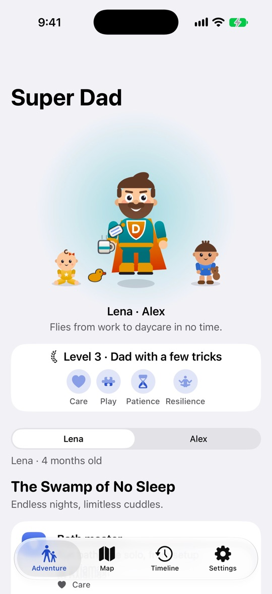

# DadSaga

> An RPG for new dads. You're the hero, your kid is your companion, and real life is the campaign.

DadSaga turns the first years of fatherhood into a game, without turning your child into a scoreboard.

- **Quests** are real things you do: a night shift, bath time, a walk on your own.
- **Boss fights** are real challenges, like the first fever or the sleep regression, and each comes with a short survival guide.
- **Legendary moments** (first smile, first steps…) are celebrated with photos when they happen, never expected by a date.
- **Saga**: the app turns those photos into a short film, whenever you ask and gently offered on each birthday.

<p align="center">
  <a href="https://dadsaga.app"></a>
  <br><sub>A 41-second tour of the real app, ending on the film it makes: <a href="web/assets/demo/demo-en.mp4">demo video</a> · <a href="https://dadsaga.app">dadsaga.app</a></sub>
</p>

This README is also the project's case study: why the app exists, the decisions that shaped it, and how it was built.

## Why

Parenting apps are written mostly for mothers, and dads find them unappealing ([JMIR Pediatrics, 2025](https://pediatrics.jmir.org/2025/1/e64171/PDF)).
Almost half of new fathers report a mental-health problem in the first two years ([Fatherhood Institute](https://www.fatherhoodinstitute.org/_files/ugd/efff1d_046d651fc2744dd99ab3d28e20e3008c.pdf)).
And parents drop baby trackers because the logging starts to feel like pressure and guilt ([University of Edinburgh](https://medicalxpress.com/news/2018-04-baby-apps-parents-guilty-pressured.html)).

So DadSaga follows a few rules (see [ADR-0006](docs/adr/0006-no-pressure-game-design.md)):

1. Titles reward the **dad's actions**, never the child's development.
2. Nothing is ever lost: no penalties and no breakable streaks.
3. Every world is open: the child's **age** sets the current world and paces its cards, never milestones.
4. One skill branch, **Resilience**, is about the dad's own wellbeing.

These rules are product requirements, not taste: they live in the Domain layer and its tests. XP comes only from what
the dad records, a world is chosen by the child's age and never locked, and when levels started to read as a score,
they were replaced by titles with no XP on screen and no "next title" hint
([ADR-0055](docs/adr/0055-dad-titles-instead-of-levels.md)).

## The constraints

- **One developer, one phone, no backend.** Everything runs on the device: no account, no server, no analytics SDK.
  A child's photos and dates never leave the iPhone unless the dad sends them
  ([ADR-0004](docs/adr/0004-offline-first-on-device-data.md)).
- **Two languages from day one.** Every card, guide and button exists in Greek and English.
- **Health information that must be right and must not scare.** The boss guides (fever, colic, the first
  vaccinations…) are short, calm, and checked claim by claim against current primary sources before they ship.
- **A foldable from day one.** The layout adapts to any window size, including the iPhone Duo half open like a laptop
  ([ADR-0011](docs/adr/0011-liquid-glass-and-adaptive-layout.md),
  [ADR-0043](docs/adr/0043-panes-above-and-below-the-fold.md)).

## Decisions worth a look

Every significant decision is an Architecture Decision Record: more than 80 of them in [`docs/adr`](docs/adr), each with what
was rejected and why. A few that show the shape of the project:

- **The saga film is drawn frame by frame on the phone**
  ([ADR-0036](docs/adr/0036-saga-video.md)). `FilmKit` composes each frame with Core Image (Ken Burns, cross-fades,
  SwiftUI cards rendered with `ImageRenderer`) and feeds an `AVAssetWriter`, with the music mixed from an
  `AVMutableComposition`. Vision picks and frames the photos while the film is made, keeping the children in shot
  ([ADR-0047](docs/adr/0047-choosing-and-framing-film-photos-on-device.md)). The film is never stored: it is made
  when asked for and handed to the share sheet.
- **The hero and the children are drawn in code**
  ([ADR-0008](docs/adr/0008-hero-classes-and-code-drawn-avatar.md)): hair, beard, glasses and gear in SwiftUI
  shapes, so the same figure appears in the app, the film and the website.
- **Game content is data.** Worlds, quests, bosses, firsts and gear are bilingual JSON, validated when loaded
  ([ADR-0005](docs/adr/0005-content-as-data.md)); adding a quest never touches Swift.
- **The store is versioned and never silently replaced**
  ([ADR-0026](docs/adr/0026-versioned-store-and-unavailable-screen.md)). If it can't be opened, the app says so
  calmly and touches nothing. The dad's own backup is one `.dadsaga` file with a manifest and checksums, checked in
  full before anything is replaced ([ADR-0057](docs/adr/0057-saga-copy-export-and-restore.md)).
- **Designed for two parents before shipping for one.** Partner co-op through iCloud
  ([ADR-0065](docs/adr/0065-partner-co-op-sync.md)) was designed before 1.0, so 1.0's frozen schema already holds
  what sync will need: stable ids, an author on every entry, a removed child marked rather than deleted. The sync core
  (a change feed from SwiftData history, field-level merge, a coordinator) ships in 1.0, tested against a fake cloud
  and wired to nothing but the trim of the store's history at launch ([ADR-0067](docs/adr/0067-1-0-ships-without-icloud.md),
  [ADR-0081](docs/adr/0081-1-0-trims-the-store-history.md)); CloudKit comes in the next version.
- **Fewer features to ship sooner.** Nothing is kept for backward compatibility before the first release
  ([ADR-0060](docs/adr/0060-nothing-ships-before-the-first-app-store-release.md)): an idea that didn't work is
  deleted, not migrated.

## How it was built

Built by one developer with Claude Code as the engineering team, in about 470 commits between 13 and 26 November 2026.
The developer is the product owner: sets the rules, answers the open questions each ADR raises, and checks the app on
a real phone. The work is
split between agents with fixed roles ([`.claude/agents`](.claude/agents)):

- an **architect** plans every change that crosses layers and drafts its ADR;
- a **reviewer** reads every pull request against the ADRs before it opens, with a stronger model for persistence,
  migrations, sync and the film;
- a **content** writer drafts the cards in both languages, and a separate **fact-check** agent checks every health
  claim against primary sources;
- a **ui-check** agent draws each UI change in the simulator (the fold, dark mode, both languages) and reports what
  it saw.

The rules they follow are in [`CLAUDE.md`](CLAUDE.md): Gitflow, one pull request per change, a test that reproduces a
bug before its fix, and deleting the old path when new code replaces it.

## In numbers

| | |
|---|---|
| Swift, app and package | ~30,000 lines |
| Tests | ~30,000 lines, 1,400+ Swift Testing tests, one target per layer, plus screen snapshots and an accessibility audit |
| Decisions | 80+ ADRs |
| Pull requests | 120+ merged into `develop` |
| Languages | Greek and English, every string and card |
| Data sent off the device | none |

## Architecture

[Clean Architecture](docs/adr/0007-clean-architecture.md): one SwiftPM target per layer, so the compiler enforces that dependencies point inward.

```
DadSaga (app)              composition root: AppContainer wires everything (DI)
Packages/DadSagaKit
├── Presentation           @Observable ViewModels → display models; SwiftUI views
├── WidgetPresentation     what the home-screen widget shows (no WidgetKit, unit-tested)
├── Localization           UI text: one String Catalog (el + en) for the app and the widget
├── Data                   repository implementations, DTOs, mappers, bundled JSON
├── Application            use cases + repository protocols (ports)
├── Domain                 entities + business rules (titles, unlocks, progress)
├── HeroArt                the code-drawn hero and children (ADR-0028)
├── DesignSystem           tokens + reusable SwiftUI components
├── FilmKit                writes a film frame by frame; Apple frameworks only, knows nothing of the game (ADR-0036)
└── SagaMusic              the saga film's five bundled tracks and their credits, carried by the app only (ADR-0036, ADR-0046)

Presentation ───────┐
WidgetPresentation ─┼─▶ Application ─▶ Domain
Data ───────────────┘

Presentation ─▶ FilmKit    drawing the saga film (ADR-0037)
```

- Swift 6 with strict concurrency, iOS 26+, Swift Testing, with a test target per layer.
- The Xcode project is generated with [XcodeGen](https://github.com/yonaskolb/XcodeGen) and isn't committed ([ADR-0003](docs/adr/0003-modular-spm-and-xcodegen.md)).
- Offline-first: photos and the child's data never leave the device ([ADR-0004](docs/adr/0004-offline-first-on-device-data.md)).
- Game content is data, not code ([ADR-0005](docs/adr/0005-content-as-data.md)); UI text lives in a String Catalog
  ([ADR-0027](docs/adr/0027-ui-string-catalog.md)).
- The on-device store is versioned and never silently replaced ([ADR-0026](docs/adr/0026-versioned-store-and-unavailable-screen.md)).

- The website [dadsaga.app](https://dadsaga.app) (landing, privacy, support in el/en) is static HTML in [`web/`](web),
  deployed by Cloudflare Pages ([ADR-0031](docs/adr/0031-website-on-cloudflare-pages.md)).

All decisions are recorded in [`docs/adr`](docs/adr).

## Getting started

```bash
brew install xcodegen swiftlint
xcodegen generate
open DadSaga.xcodeproj
```

Run the package tests (no simulator needed):

```bash
cd Packages/DadSagaKit && swift test --build-system swiftbuild
```

## Roadmap

See [docs/ROADMAP.md](docs/ROADMAP.md).

## Disclaimer

DadSaga's guides are general information, not medical advice. Always consult your child's doctor.

## Copyright

© FAFOUTIS BROTHERS E.E. The code and the content are public to read only; no licence to use, copy or change them is given.
